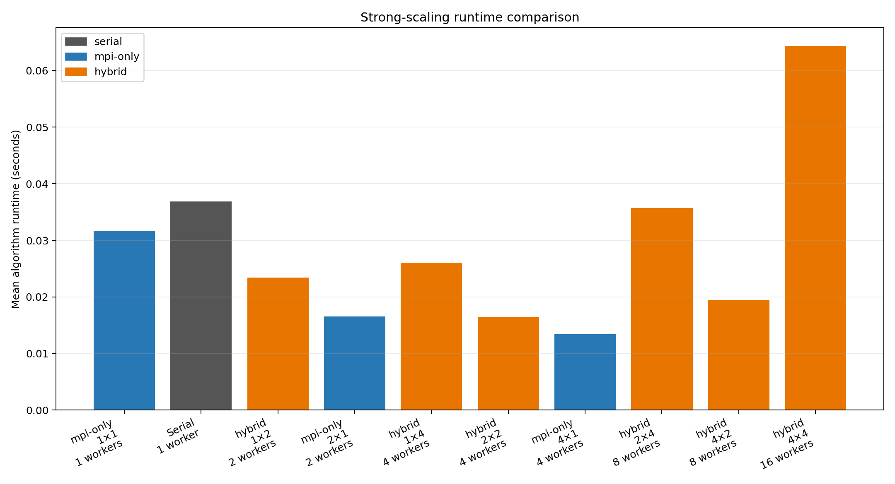
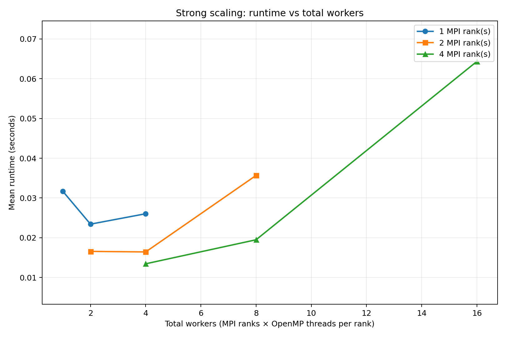
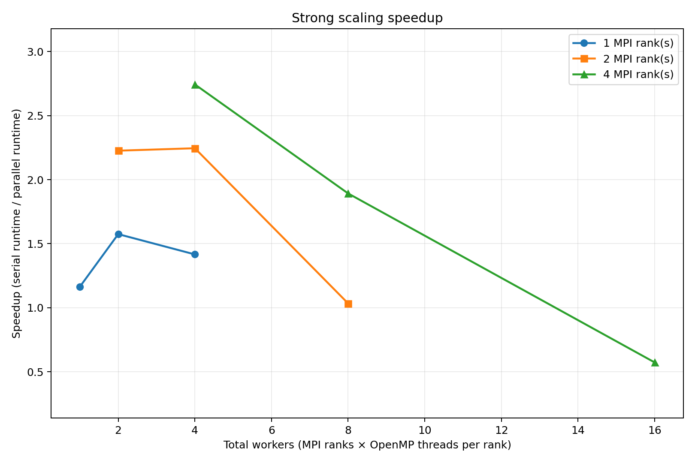
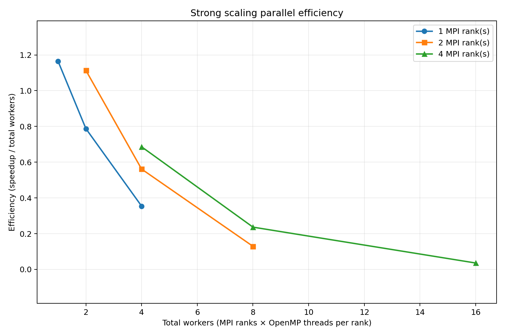
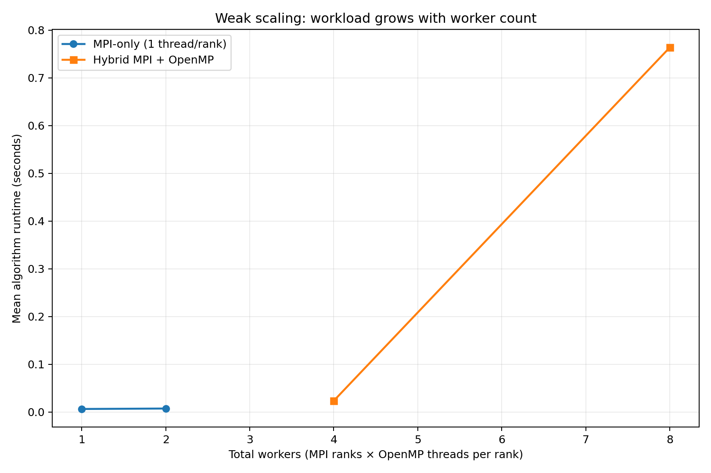

# Parallel K-Means Clustering with MPI and OpenMP

## Technical Report

**Course:** Parallel and Distributed Computing  
**Implementation:** C++17, MPI, OpenMP  
**Evaluation environment:** Ubuntu 26.04 LTS on WSL2

## Abstract

This project implements K-Means clustering in three forms: a serial C++ baseline, an MPI-distributed version, and a hybrid MPI + OpenMP version. MPI partitions a row-major synthetic dataset among processes. Each process assigns its local points and accumulates cluster totals; in the hybrid version, OpenMP threads use private accumulators before the rank merges them. MPI collectives combine the rank totals and distribute the same updated centroid model to every rank. Deterministic K-Means++ initialization, convergence checks, empty-cluster handling, and a Python benchmark workflow support correctness checks and performance evaluation.

The final validation built the serial-only and MPI/OpenMP configurations from the current source tree. A 36-attempt benchmark set using two repetitions passed return-code, convergence, centroid, SSE, and reproducibility checks. The measured performance was mixed: four MPI ranks with one thread per rank achieved the best runtime in the strong-scaling set, while the 16-worker hybrid configuration was slower than serial. A revised weak-scaling run converged at all sizes after increasing the iteration cap, but its iteration counts varied substantially, so it does not establish ideal weak scaling.

## 1. Introduction

K-Means is an unsupervised clustering method. It groups observations by repeatedly assigning each point to the nearest centroid and moving each centroid to the mean of its assigned points. The assignment work is approximately proportional to `N × K × D` per iteration, where `N` is the number of points, `K` the number of clusters, and `D` the number of coordinates per point.

This project studies where distributed and shared-memory parallelism fit into that workload. MPI distributes point ownership across processes with separate address spaces. OpenMP divides each process's local point-assignment loop among threads that share memory.

## 2. Problem Statement

A serial implementation is easy to reason about but may take longer as the dataset grows. Parallel implementations can process independent points concurrently, but they also add synchronization, local accumulation, and communication. The project therefore needs both a correctness baseline and measured results that show where the parallel overhead is worthwhile.

## 3. Objectives

- Generate deterministic Gaussian blobs with known generating centers.
- Implement K-Means++ initialization and a serial correctness baseline.
- Distribute points unevenly across MPI ranks when necessary.
- Parallelize rank-local assignment with OpenMP.
- Avoid shared-write races using thread-local cluster sums and counts.
- Combine partial results with MPI reductions and update centroids consistently.
- Measure runtime, speedup, efficiency, convergence, iterations, and SSE.
- Preserve raw benchmark attempts and create plots from recorded CSV summaries.

## 4. K-Means Algorithm

For a point `x_i` and centroid `c_j`, the implementation compares squared Euclidean distance:

`d²(x_i, c_j) = Σ_d (x_i[d] - c_j[d])²`

Square roots are unnecessary when only selecting the nearest centroid. Once the assignments are known, each non-empty cluster centroid becomes the coordinate-wise mean of its assigned points. If a cluster has no points, its previous centroid is retained.

The algorithm uses K-Means++ to select starting points. The first point is selected from the seeded random generator. Later points are sampled with probability proportional to their squared distance from the nearest selected centroid. The same seed and generated data make the serial and MPI initial centroids reproducible.

## 5. Serial Implementation

`src/main.cpp` parses options, generates the dataset, initializes centroids, runs the serial algorithm, and prints the model and metrics. `src/kmeans_serial.cpp::run_serial_kmeans` iterates through points serially, finds each closest centroid, updates sums and counts, computes the new centroids, and checks the largest centroid movement. It performs a final pass to calculate inertia (the sum of squared distances to the final centroids).

The serial timing begins after data generation and K-Means++ initialization. It includes iterative assignment/update work and the final inertia pass. The returned result includes assignments, centroids, iteration count, convergence state, SSE, and elapsed seconds.

## 6. MPI Architecture

`src/main_mpi.cpp` initializes MPI with `MPI_THREAD_FUNNELED`, obtains rank and world size, configures OpenMP, and generates the full dataset only on rank 0. `src/kmeans_mpi.cpp::run_mpi_kmeans` broadcasts the dataset shape and initial centroids, partitions points, distributes them, then executes the iterative distributed algorithm.

An MPI rank is a process with its own memory. Rank 0 is the root: it generates the dataset and computes K-Means++ centroids. Every rank receives its own local point buffer. MPI is called by the main thread only; worker threads do not call MPI.

## 7. OpenMP Architecture

Each MPI process enters an OpenMP parallel region and uses `omp for schedule(static)` over local points. Static scheduling divides the loop into predictable chunks. Each point is independent during nearest-centroid assignment, so this loop can be parallelized without changing point ownership.

Every OpenMP thread writes to its own `thread_sums` and `thread_counts` slice. This avoids races that would occur if multiple threads incremented the same cluster count or coordinate sum. After the parallel region's implicit barrier, the main thread merges the private slices into rank-local sums and counts. Storage for private sums is proportional to `threads × clusters × dimensions`; the implementation does not pad each slice to cache-line boundaries.

## 8. Hybrid MPI and OpenMP Workflow

One algorithm iteration follows this sequence:

1. Clear rank-level and thread-level sums and counts.
2. Parallelize local point assignment across OpenMP threads.
3. Merge each thread's private accumulators into its rank totals.
4. Use `MPI_Allreduce` to sum cluster coordinates and counts across ranks.
5. Update all non-empty cluster centroids identically on every rank.
6. Stop if the maximum centroid shift is within tolerance; otherwise continue until the iteration cap.

The OpenMP parallel region finishes before MPI reductions begin. This synchronization means no worker thread is still writing to local accumulators while the main thread merges them or calls MPI.

## 9. Data Distribution and Collective Communication

The program divides `N` by the number of ranks. Each rank receives `N / P` points, and the first `N % P` ranks receive one additional point. This handles uneven partitions. The point buffer is contiguous and row-major.

`MPI_Scatterv` accepts a separate element count and displacement for each rank, so uneven partitions can be sent from rank 0 in one collective. Initial centroid values are broadcast with `MPI_Bcast`; this ensures that every process starts the same model. Each iteration uses `MPI_Allreduce` for sums and counts. Unlike a root-only reduction, all ranks receive the combined values, allowing each rank to update centroids and check convergence with the same data.

The implementation validates dimensions against the classic MPI `int` count/displacement limit before allocating or communicating. Rank 0 temporarily holds the entire dataset before the scatter.

## 10. Thread-Local Accumulation and Synchronization

Cluster counts and coordinate sums are shared outputs of point assignment, but the implementation avoids locks and atomics in the hot loop. A thread updates only its own accumulator slice. After all threads leave the parallel region, the main thread merges slices in a deterministic loop. MPI then combines rank-local totals. Floating-point summation order can differ from serial, so correctness is assessed with tolerances rather than bit-for-bit equality.

## 11. Convergence and Termination

After every centroid update, the implementation measures the maximum Euclidean shift among centroids. If that value is at most the configured tolerance, the iteration stops and `converged` is true. Otherwise it continues up to `--max-iterations`. Empty clusters do not produce division by zero; their previous centroids are retained. Because all ranks receive the same global counts and sums, they take the same convergence decision.

The benchmark runner now records the `Converged` field and requires serial and parallel runs to agree on it as well as iteration count, centroid tolerance, and SSE tolerance. Reaching the iteration cap is therefore visible even when the serial and parallel outputs match.

## 12. Experimental Environment

The final build and benchmark commands ran in Ubuntu 26.04 LTS on WSL2. The verified software versions were GCC/G++ 15.2.0, CMake 4.2.3, Open MPI 5.0.10, OpenMP 4.5, and Python 3.14.4. `nproc` reported 8 available logical processors during validation. No CPU model or affinity data was captured, so none is claimed here.

Matplotlib 3.9.4 was already present in the Windows Python 3.9 environment and was used to generate the PNG plots. WSL's Python did not have Matplotlib or `ensurepip`, so a WSL project virtual environment could not be created without adding the distribution's `python3.14-venv` package. No system package was installed for this phase.

## 13. Benchmark Methodology

The benchmark runner is `scripts/benchmark.py`. It uses the same point count, dimensions, cluster count, seed, standard deviation defaults, tolerance, and iteration cap for each serial/parallel comparison. Synthetic datasets and initial centroids are regenerated deterministically with the same seed. Every attempt records its command, return code, configuration, runtime, iterations, convergence state, SSE, correctness status, reproducibility status, and diagnostic text.

Reported algorithm runtime excludes synthetic data generation and K-Means++ initialization in both implementations. Serial runtime includes the assignment/update iterations and final inertia pass. MPI runtime begins after dataset distribution and centroid broadcast; it includes assignment, thread-buffer merging, MPI reductions, centroid updates, and final inertia, and reports the slowest rank. MPI launcher startup and wall time are recorded separately for context, but speedup uses application runtime. Consequently, this speedup is for the timed algorithm region, not full process startup or end-to-end data preparation.

Speedup is `serial runtime / parallel runtime`. Parallel efficiency is `speedup / total workers`, with total workers equal to `MPI ranks × OpenMP threads per rank`. MPI-only runs use one thread per rank. Each result below uses mean application runtime from two repetitions. The benchmark summary retains standard deviation and all raw attempts.

## 14. Strong-Scaling Results

Strong scaling kept N=100,000, D=32, K=5, seed=42, tolerance=0.001, and a 500-iteration cap fixed. All configurations converged in two iterations. The serial mean was 0.036870500 seconds. Every configuration had SSE approximately 3,202,258.706455.

| Mode | Ranks × threads/rank | Workers | Mean runtime (s) | Speedup | Efficiency | Iterations |
|---|---:|---:|---:|---:|---:|---:|
| Serial | 1 × 1 | 1 | 0.036871 | 1.000 | 1.000 | 2 |
| MPI-only | 1 × 1 | 1 | 0.031660 | 1.165 | 1.165 | 2 |
| Hybrid | 1 × 2 | 2 | 0.023412 | 1.575 | 0.787 | 2 |
| Hybrid | 1 × 4 | 4 | 0.026030 | 1.416 | 0.354 | 2 |
| MPI-only | 2 × 1 | 2 | 0.016560 | 2.226 | 1.113 | 2 |
| Hybrid | 2 × 2 | 4 | 0.016420 | 2.246 | 0.561 | 2 |
| Hybrid | 2 × 4 | 8 | 0.035668 | 1.034 | 0.129 | 2 |
| MPI-only | 4 × 1 | 4 | 0.013437 | 2.744 | 0.686 | 2 |
| Hybrid | 4 × 2 | 8 | 0.019483 | 1.892 | 0.237 | 2 |
| Hybrid | 4 × 4 | 16 | 0.064344 | 0.573 | 0.036 | 2 |

All parallel configurations matched their serial reference. Across the 26 parallel rows in the full run, the largest maximum absolute centroid difference was `4.996e-7`; the largest absolute SSE difference was `3.683e-7`. Both are below their configured thresholds. All two-run model reproducibility checks passed.

### Runtime comparison

### Strong-scaling runtime

### Speedup

### Parallel efficiency

## 15. Weak-Scaling Results

The original weak-scaling base was 20,000 points per worker. The first run used a 100-iteration cap and the largest case reached that cap. The follow-up used the same dimensions, cluster count, seed, tolerance, and points-per-worker method but raised the cap to 500. The 160,000-point case then converged in 172 iterations. The new run had two repetitions and all serial and parallel references converged and matched.

| Workers | Ranks × threads/rank | Mode | Points | Serial reference (s) | Parallel mean (s) | Speedup | Efficiency |
|---:|---:|---|---:|---:|---:|---:|---:|
| 1 | 1 × 1 | MPI-only | 20,000 | 0.007171 | 0.006269 | 1.144 | 1.144 |
| 2 | 2 × 1 | MPI-only | 40,000 | 0.014659 | 0.007226 | 2.029 | 1.014 |
| 4 | 2 × 2 | Hybrid | 80,000 | 0.034451 | 0.023430 | 1.470 | 0.368 |
| 8 | 4 × 2 | Hybrid | 160,000 | 3.123535 | 0.763506 | 4.091 | 0.511 |

| Points | Serial iterations | Parallel iterations | Converged | Parallel SSE |
|---:|---:|---:|:---:|---:|
| 20,000 | 2 | 2 | yes | 640,245.213463 |
| 40,000 | 2 | 2 | yes | 1,281,773.957666 |
| 80,000 | 3 | 3 | yes | 2,561,947.843404 |
| 160,000 | 172 | 172 | yes | 23,711,673.702115 |

The follow-up resolves the earlier failure to converge within 100 iterations, but it does not establish constant weak-scaling time. The largest workload required 172 iterations while the others required 2 or 3. Since runtime scales with both point count and iteration count, the observed increase cannot be attributed to worker scaling alone. The same seed keeps each run reproducible but does not guarantee identical K-Means++ starting points as the dataset size changes.

## 16. Performance Analysis

Four MPI ranks with one thread each produced the lowest strong-scaling runtime, 0.013437 seconds, about 2.744× the serial speedup by the specified ratio. The best measured hybrid result was two ranks × two threads at 0.016420 seconds. More workers did not consistently reduce runtime. The 4 × 4 configuration used 16 workers while WSL reported eight available logical processors, so it oversubscribed that reported capacity and was slower than serial.

The source includes costs that are visible in the timed region: OpenMP team entry, thread-private accumulator clearing, per-thread merging, and two MPI global reductions per iteration. These are plausible contributors to overhead, particularly for the small number of iterations in the strong-scaling workload. The benchmark did not profile or isolate their individual costs, and did not record CPU affinity or OS scheduling; therefore the measurements do not prove a single cause. The two-repetition sample and millisecond-scale runtimes also make these results a demonstration rather than a broad performance characterization.

Efficiency above 1 was observed for the one-worker and two-worker MPI rows. This is the formula's measured ratio, not a claim that the machine exceeded an ideal hardware bound. Short runtimes, sample variation, scheduling, and timing-region boundaries can produce such ratios; the serial baseline had a 0.009068644-second sample standard deviation in this two-run strong test.

## 17. F1–F7 Compliance

| Requirement | Status and implementation evidence | Test evidence | Remaining limit |
|---|---|---|---|
| F1 MPI partition/distribution | Implemented in `src/kmeans_mpi.cpp::run_mpi_kmeans`: row-major local buffers, uneven counts/displacements, `MPI_Scatterv`. | Fresh-build benchmark used N=10,003 with 1, 2 and 4 ranks; all runs passed, including uneven partitions. | Rank 0 temporarily stores the full generated dataset; MPI counts/displacements use `int` and oversized shapes are rejected. |
| F2 K-Means++ and broadcast | `src/kmeans_common.cpp::initialize_kmeans_plus_plus`; root initializes and `run_mpi_kmeans` broadcasts centroid values with `MPI_Bcast`. | Same seeded serial references matched all MPI/hybrid centroids; two repetitions were reproducible. | Initialization remains on rank 0 and is outside application runtime. |
| F3 OpenMP assignment | `src/kmeans_mpi.cpp`: `omp parallel` and `omp for schedule(static)` parallelize local point assignment. | Fresh binary observed requested teams across 1×2, 1×4, 2×2, 2×4, 4×2 and 4×4 configurations. | No dynamic load balancing; each point has similar cost, but memory/scheduling effects vary. |
| F4 Thread-local sums/counts | `thread_sums` and `thread_counts` are private per-thread slices; main thread merges after parallel-region barrier. | Multi-thread configurations matched serial results within tolerance. | No cache-line padding; memory scales with threads × K × D. |
| F5 MPI global reduction/update | Two `MPI_Allreduce` calls combine sums/counts; every rank updates the same centroids. Empty clusters keep their prior centroid. | 1, 2 and 4 rank runs passed centroid/SSE comparisons; empty-cluster handling was covered in Phase 5 validation. | Floating-point reduction order can cause small numeric differences. |
| F6 Convergence/termination | Serial and MPI code compare maximum centroid movement with tolerance and enforce maximum iterations. | Fresh runner records convergence; revised 160,000-point test converged in 172 of 500 allowed iterations; serial and parallel flags matched. | Some seeds/data may reach the configured iteration cap without convergence. |
| F7 Measurement/scaling | `scripts/benchmark.py`, `scripts/plot_results.py`, CSV output and five plots. | 36-attempt two-repetition run had 0 failures; all five PNGs were generated from its summary and viewed. | Timing excludes data generation, initialization, and MPI distribution; two repetitions and one synthetic workload are limited evidence. |

## 18. Limitations and Future Improvements

- Only synthetic Gaussian blobs were used; behavior on real datasets has not been measured.
- Rank 0 generates and temporarily owns the full dataset, which limits memory scalability.
- MPI `Scatterv` uses classic `int` counts and displacements; large inputs beyond that limit are rejected.
- The normal CLI does not gather all final point labels to rank 0 or write them to a file.
- Thread-local buffers use `threads × clusters × dimensions` storage and are not cache-line padded.
- Application runtime excludes dataset generation, K-Means++ initialization, and initial MPI distribution; end-to-end runtime can be larger.
- Weak scaling remains difficult to interpret because iteration counts differ with dataset size and K-Means++ sample choices.
- The benchmark uses two repetitions for the submitted tables and has no CPU profiler, affinity control, or memory-bandwidth counters.
- WSL Python 3.14 lacks `ensurepip` and Matplotlib; the local venv was not created. The five final PNGs were generated with the preinstalled Windows Python/Matplotlib environment, without installing system packages.

Future improvements include a controlled benchmark mode that supplies identical initial centroids across increasing weak-scaling datasets, more repetitions with warm-up and randomized configuration order, end-to-end timing, CPU affinity control, hardware counter profiling, and optional label gathering/export.

## 19. Conclusion

All three builds and the 36-attempt correctness set passed. MPI and selected hybrid settings reduced measured runtime, but 16 workers were slower than serial. The results support a workload- and resource-dependent conclusion, not a universal scalability claim.
